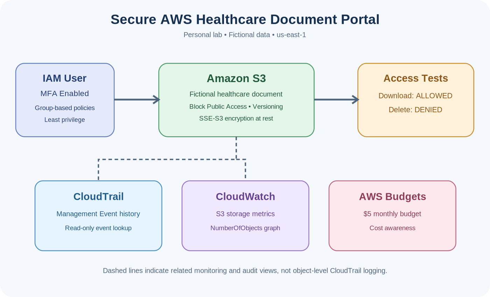

# Secure AWS Healthcare Document Portal

## Project Overview
A hands-on AWS cloud security lab demonstrating how a fictional healthcare organization can protect documents using identity and access management, restricted storage permissions, encryption, monitoring, and audit visibility.

This is an educational project using fictional data only. It is not a production healthcare system or a claim of HIPAA certification.

## AWS Services and Technologies
- AWS Identity and Access Management (IAM)
- Multi-Factor Authentication (MFA)
- Amazon S3
- Amazon S3 server-side encryption (SSE-S3)
- AWS CloudTrail Event history
- Amazon CloudWatch metrics
- AWS Budgets
- AWS Key Management Service (KMS) concepts

## Security Architecture

## Security Controls Implemented
- Enabled MFA for the root account and restricted IAM user.
- Created an IAM group with scoped S3 permissions.
- Configured an S3 bucket with Block Public Access enabled.
- Enabled S3 versioning and default SSE-S3 encryption.
- Used fictional healthcare documents to validate authorized access.
- Reviewed AWS management events in CloudTrail Event history.
- Viewed Amazon S3 NumberOfObjects metrics in CloudWatch.
- Configured a $5 monthly AWS Budget.

## Security Testing Results
| Security Test | Expected Outcome | Verified Result |
| --- | --- | --- |
| Download an authorized S3 document | Allowed | PASS — Download successful |
| Delete a protected S3 document | Denied | PASS — Access Denied |
| Review IAM user activity in CloudTrail | Events visible | PASS — Management events found |

## Important Technical Notes
- S3 object-level operations are not automatically included in CloudTrail Event history. Separate data-event logging would be required to audit those operations.
- SSE-S3 was implemented. Customer-managed KMS keys and SSE-KMS were studied but not configured.
- No dedicated CloudTrail trail, CloudWatch alarm, or production deployment is claimed.

## Skills Demonstrated
AWS IAM, MFA, least privilege, S3 access controls, secure document storage, encryption, AWS audit review, CloudWatch metrics, troubleshooting, security validation, and technical documentation.

## Portfolio Documentation
- [Architecture Diagram](diagrams/architecture.png)
- [Resume and LinkedIn Descriptions](LINKEDIN_AND_RESUME.md)
- [Screenshot Evidence Email Templates](SCREENSHOT_EMAILS.md)

## Project Status
Seven-day hands-on AWS security lab completed. GitHub documentation published; sanitized evidence screenshots may be added separately.
